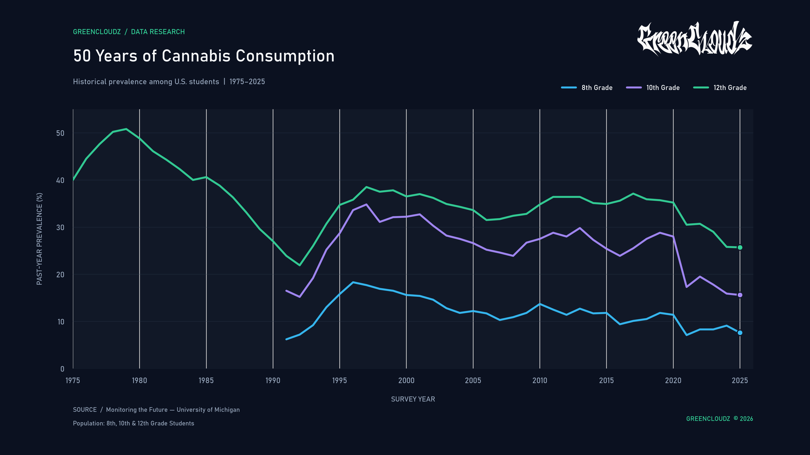
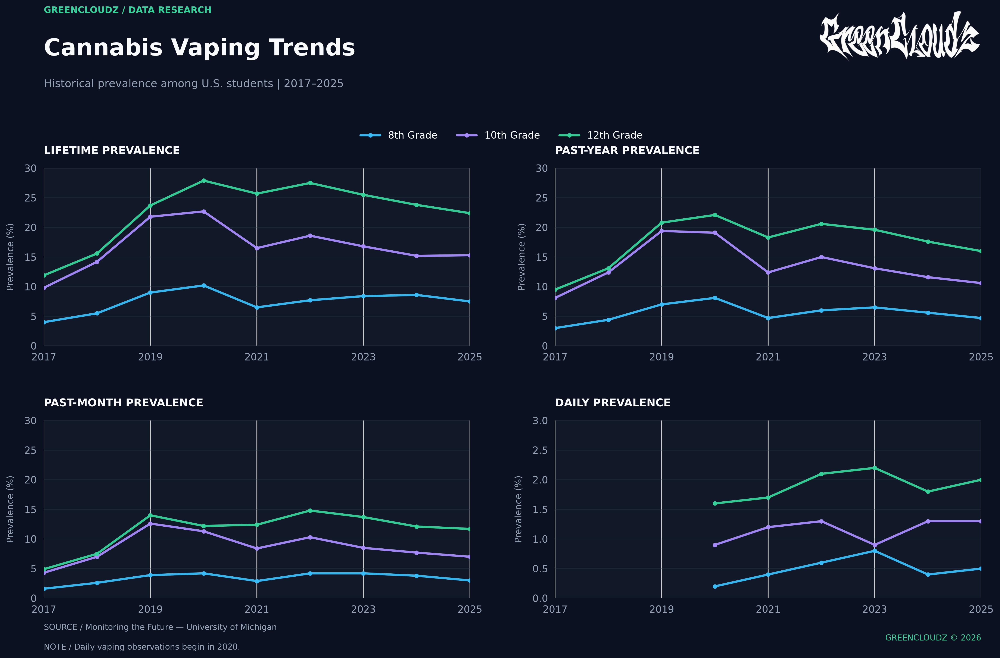
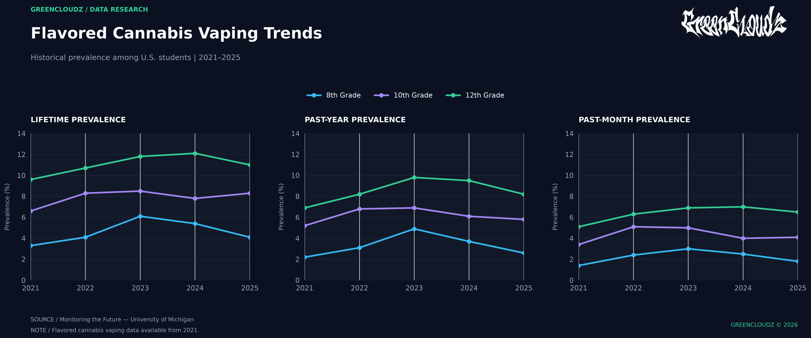
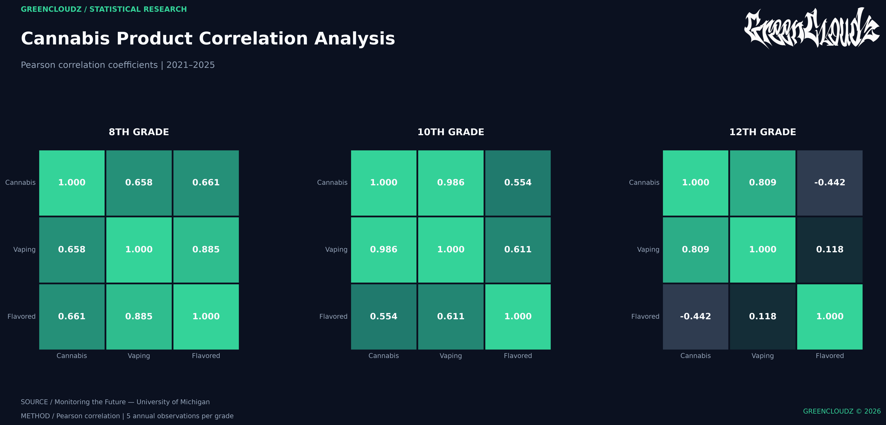

<div align="center">


# Cannabis Consumption Trends

### A Statistical Analysis of Cannabis-Related Prevalence Among U.S. Adolescents (1975–2025)

**Exploratory Data Analysis · Statistical Research · Data Visualization**


**Data Source:** Monitoring the Future (MTF) — University of Michigan

[Research Report](reports/Greencloudz_Cannabis_Consumption_Research_Report.pdf) · [Methodology](docs/methodology.md) · [Data Sources](docs/data_sources.md)

</div>

---

## 1. Project Overview

Cannabis Consumption Trends is a data analytics research project examining historical cannabis-related prevalence among U.S. adolescents.

Using published prevalence estimates from the University of Michigan's Monitoring the Future study, the project investigates how cannabis consumption patterns have evolved across educational grades, product categories, and reporting intervals.

The research combines data processing, exploratory analysis, descriptive statistics, linear regression, and correlation analysis to identify historical patterns and evaluate recent changes.

The project emphasizes analytical reproducibility, transparent methodology, and responsible statistical interpretation.

### Research Scope

| Attribute | Description |
|---|---|
| Geographic Coverage | United States |
| Historical Coverage | 1975–2025 |
| Population | 8th, 10th, and 12th-grade students |
| Original Datasets | 13 CSV files |
| Processed Observations | 660 |
| Product Categories | 5 |
| Primary Comparative Period | 2021–2025 |
| Analysis Environment | Python 3.12, Jupyter |

---

## 2. Research Objectives

The investigation addresses five research questions:

1. How has cannabis prevalence evolved across educational grades since 1975?
2. How did cannabis prevalence change between 2021 and 2025?
3. How do cannabis vaping trends compare with general cannabis prevalence?
4. How has flavored cannabis vaping evolved across educational grades?
5. How do statistical relationships between cannabis-related indicators vary across educational grades?

The research focuses on historical patterns and descriptive relationships rather than causal inference.

---

## 3. Key Research Findings

### Finding 1 — Historical Cannabis Prevalence

Cannabis prevalence has experienced substantial historical fluctuations.

The highest observed past-year prevalence estimates were:

| Grade | Peak Prevalence | Year |
|---|---:|---:|
| 8th Grade | 18.3% | 1996 |
| 10th Grade | 34.8% | 1997 |
| 12th Grade | 50.8% | 1979 |

The available historical series demonstrates that cannabis prevalence has not followed a consistently increasing or decreasing trajectory.



### Finding 2 — Recent Cannabis Prevalence Changes

Between 2021 and 2025, past-year cannabis prevalence decreased among older students.

| Grade | 2021 | 2025 | Change |
|---|---:|---:|---:|
| 8th Grade | 7.1% | 7.6% | +0.5 pp |
| 10th Grade | 17.3% | 15.6% | −1.7 pp |
| 12th Grade | 30.5% | 25.7% | −4.8 pp |

The largest observed decline occurred among 12th-grade students.

### Finding 3 — Cannabis Vaping Trends

Cannabis vaping exhibited different net changes across educational grades.

| Grade | 2021 | 2025 | Change |
|---|---:|---:|---:|
| 8th Grade | 4.7% | 4.7% | 0.0 pp |
| 10th Grade | 12.4% | 10.6% | −1.8 pp |
| 12th Grade | 18.3% | 16.0% | −2.3 pp |

Although vaping prevalence declined among older students, the annual trajectories included intermediate increases and subsequent decreases.



### Finding 4 — Flavored Cannabis Vaping

Flavored cannabis vaping showed positive net changes across all three educational grades between 2021 and 2025.

| Grade | 2021 | 2025 | Change |
|---|---:|---:|---:|
| 8th Grade | 2.2% | 2.6% | +0.4 pp |
| 10th Grade | 5.2% | 5.8% | +0.6 pp |
| 12th Grade | 6.9% | 8.2% | +1.3 pp |

These net increases contrast with the decreases observed in general cannabis vaping among 10th- and 12th-grade students.

However, positive net changes do not imply continuous annual growth or demonstrate substitution between consumption methods.



### Finding 5 — Cross-Category Statistical Relationships

Pearson correlation analysis identified relationships that varied across educational grades and statistical approaches.

The strongest observed prevalence-level correlation occurred between general cannabis and cannabis vaping among 10th-grade students:

**Pearson correlation: r = 0.986**

However, the correlation estimates were calculated using only five annual observations.

Additional correlations based on year-over-year changes used only four observations.

Consequently, these results are exploratory and should not be interpreted as statistically conclusive or causal.



---

## 4. Data Source and Coverage

The project uses published prevalence estimates from:

**Monitoring the Future (MTF)**  
University of Michigan  
Supported by the National Institute on Drug Abuse (NIDA)

Official website:

https://monitoringthefuture.org/

### Product Categories

The dataset includes:

| Product Category | Reporting Intervals |
|---|---|
| Cannabis | Lifetime, 12 Month, 30 Day, Daily |
| CBD | 12 Month |
| Medical Cannabis | Lifetime |
| Vaping Cannabis | Lifetime, 12 Month, 30 Day, Daily |
| Vaping Flavored Cannabis | Lifetime, 12 Month, 30 Day |

Historical coverage differs across indicators.

The 12th-grade cannabis series begins in 1975, while the 8th- and 10th-grade series begin in 1991.

No observations were invented or interpolated to fill unavailable historical periods.

The processed dataset contains five columns:

`drug`, `time`, `grade`, `estimate`, and `year`.

The `estimate` column represents prevalence percentages rather than respondent counts.

---

## 5. Analytical Methodology

The project follows a structured research workflow.

### Stage 1 — Data Processing

- Load and consolidate source CSV files.
- Standardize the dataset structure.
- Validate required columns.
- Identify missing values and duplicate observations.
- Verify prevalence boundaries.
- Preserve original historical observations.

### Stage 2 — Exploratory Data Analysis

- Historical prevalence trends.
- Educational-grade comparisons.
- Product-specific prevalence analysis.
- Reporting-interval comparisons.
- Historical peak identification.
- Baseline and final-year comparisons.

### Stage 3 — Statistical Analysis

- Year-over-year changes.
- Descriptive variability.
- Linear trend estimation.
- Coefficient of determination (R²).
- Pearson correlation analysis.
- Correlations between annual prevalence changes.

### Stage 4 — Research Interpretation

- Consolidate principal findings.
- Compare historical patterns.
- Evaluate statistical limitations.
- Document survey methodology.
- Produce the final research report.

All statistical relationships are interpreted within the limitations of aggregated survey data.

---

## 6. Statistical and Methodological Limitations

Several limitations affect interpretation:

**Survey Coverage:** MTF is a school-based survey and does not represent all adolescents outside the school system.

**Historical Comparability:** Survey coverage differs across educational grades and product categories.

**COVID-19 Disruptions:** Data collection during 2020 was affected by the pandemic.

**Survey Administration:** Changes in administration during 2021 require consideration when interpreting historical differences.

**Methodological Updates:** Sampling and questionnaire changes introduced in 2024 may affect comparisons.

**Aggregate Data:** Individual-level consumption behavior cannot be identified.

**Statistical Uncertainty:** The processed dataset does not contain sufficient survey design information to perform rigorous design-based statistical inference.

**Short Time Series:** Recent regression and correlation analyses rely on a limited number of annual observations.

**Overlapping Categories:** Cannabis-related prevalence indicators may represent overlapping populations and should not be added together.

The investigation does not claim causality or statistically significant population changes.

Further methodological details are available in [docs/methodology.md](docs/methodology.md).

---

## 7. Project Structure

```text
cannabis-consumption-trends/
|
|-- assets/
|   `-- branding/
|
|-- data/
|   |-- raw/
|   |-- interim/
|   `-- processed/
|
|-- docs/
|   |-- data_sources.md
|   |-- methodology.md
|   `-- research_questions.md
|
|-- notebooks/
|   |-- 01_exploratory_data_analysis.ipynb
|   |-- 02_statistical_analysis.ipynb
|   `-- 03_research_findings.ipynb
|
|-- reports/
|   |-- figures/
|   |-- findings/
|   `-- Greencloudz_Cannabis_Consumption_Research_Report.pdf
|
|-- src/
|   |-- __init__.py
|   |-- data_processing.py
|   |-- analysis.py
|   `-- visualization.py
|
|-- tests/
|   |-- test_analysis.py
|   `-- test_official_estimates.py
|
|-- .gitignore
|-- requirements.txt
|-- LICENSE
`-- README.md
```

---

## 8. Installation and Reproducibility

### Requirements

- Python 3.12
- Git
- Jupyter-compatible development environment

### Clone the Repository

```bash
git clone <REPOSITORY_URL>
cd cannabis-consumption-trends
```

Replace `<REPOSITORY_URL>` with the published GitHub repository URL.

### Create a Virtual Environment

```bash
python -m venv .venv
```

Activate the environment on Windows PowerShell:

```powershell
.\.venv\Scripts\Activate.ps1
```

### Install Dependencies

```bash
python -m pip install -r requirements.txt
```

### Prepare the Data

The notebooks expect the processed dataset at:

```text
data/processed/cannabis_prevalence_clean.csv
```

If the source CSV files are available in `data/raw/`, the processed dataset can be regenerated using:

```python
from src.data_processing import (
    load_raw_data,
    clean_prevalence_data,
    validate_prevalence_data,
    save_processed_data,
)

raw_data = load_raw_data("data/raw")
clean_data = clean_prevalence_data(raw_data)

validation = validate_prevalence_data(clean_data)

if not validation["all_passed"]:
    raise ValueError("Dataset validation failed.")

save_processed_data(
    clean_data,
    "data/processed/cannabis_prevalence_clean.csv",
)
```

Source-data redistribution may be subject to third-party terms.

### Execute the Notebooks

Open the `notebooks/` directory and run the notebooks in the following order:

1. `01_exploratory_data_analysis.ipynb`
2. `02_statistical_analysis.ipynb`
3. `03_research_findings.ipynb`

Select the Python environment created during installation.

The notebooks are designed to execute with the `notebooks/` directory as their working directory.

### Run Automated Tests

```bash
python -m pytest tests/ -v
```

The project also includes a separate official-estimate validation script:

```bash
python tests/test_official_estimates.py
```

---

## 9. Technologies and Skills Demonstrated

### Technologies

- Python
- Pandas
- NumPy
- Matplotlib
- Seaborn
- SciPy
- Jupyter Notebook
- Pytest
- Git

### Analytical Skills

- Data Cleaning and Validation
- Exploratory Data Analysis
- Descriptive Statistics
- Time-Series Exploration
- Linear Regression
- Pearson Correlation
- Statistical Interpretation
- Research Documentation
- Data Visualization
- Reproducible Analytical Workflows

---

## 10. Research Report

The complete research report consolidates the study's methodology, principal results, visualizations, statistical limitations, and references.

**[View the Greencloudz Research Report (PDF)](reports/Greencloudz_Cannabis_Consumption_Research_Report.pdf)**

Additional visualizations are available in:

[reports/figures/](reports/figures/)

---

## 11. Official References

**University of Michigan — Monitoring the Future**

https://monitoringthefuture.org/

**Monitoring the Future — Drug Prevalence Data**

https://monitoringthefuture.org/data/bx-by/drug-prevalence/

**Centers for Disease Control and Prevention — Monitoring the Future**

https://www.cdc.gov/nchs/hus/sources-definitions/mtf.htm

**Inter-university Consortium for Political and Social Research (ICPSR)**

https://www.icpsr.umich.edu/

For additional methodological details, consult the documentation provided in the `docs/` directory.

---

## 12. License and Data Attribution

The original software code is distributed under the MIT License.

See [LICENSE](LICENSE).

Monitoring the Future data and third-party materials remain subject to their respective ownership and reuse conditions.

The MIT License does not grant additional rights to third-party datasets, trademarks, or branding assets.

---

<div align="center">

**GREENCLOUDZ**

*Data Analytics · Statistical Research · Evidence-Based Insights*

© 2026 Greencloudz

</div>